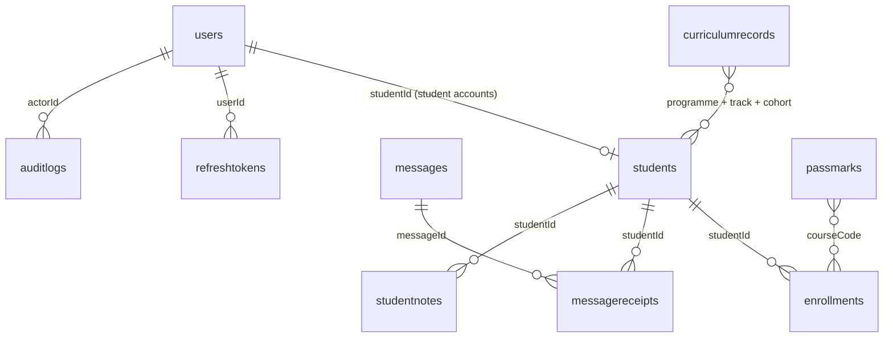

# Data model

MongoDB collections, with their Mongoose models in `web-app/backend/src/models.ts` and `src/models/curriculum.ts`. Every collection is additive: an older build can run against a newer database.

| Collection | Key fields | Indexes | Notes |
|---|---|---|---|
| `users` | `identifier` (student or staff ID), `passwordHash` (Argon2id, never selected by default), `role`, `studentId`, `forcePasswordChange`, `failedLogins`, `lockedUntil`, `synthetic` | `identifier` unique, `studentId`, `synthetic` | Admins come from `SEED_ADMIN_*`, Settings or the seeding workflows |
| `refreshtokens` | `tokenHash`, `userId`, `familyId`, `expiresAt`, `revokedAt`, `replacedByHash` | `tokenHash` unique, TTL on `expiresAt` | Only hashes are stored; reuse of a rotated token revokes its family |
| `auditlogs` | `action`, `actorId`, `actorRole`, `subject`, `metadata`, `requestId`, `ip`, `at` | `action`, `subject`, `at` | Append-only; actions are listed in `repositories/types.ts` (`AuditAction`) |
| `students` | `studentId`, `fullName`, `programme`, `yearGroup`, `track`, `synthetic` | `studentId` unique; `programme`+`yearGroup` | |
| `enrollments` | `studentId`, `courseCode`, `attempts[]` (`credits`, `grade`, `status`, `semester`, `attemptedAt`), `synthetic` | `studentId`+`courseCode` unique | Attempts oldest first; the last one counts |
| `curriculumrecords` | `programme`, `track`, `version`, `status` (DRAFT/REVIEWED/SUPERSEDED), `rules`, `sources[]`, `validationIssues[]`, `review` | | Only REVIEWED records with no issues are used, chosen by cohort year |
| `passmarks` | `courseCode`, `minimumGrade` (D+ or C), `note`, `updatedBy`, `updatedAt` | `courseCode` unique | Overrides curriculum pass marks; unset courses pass at D+ |
| `settings` | `_id: "app"`, `standing` (`normalLoad`, `maxLoad`, `criticalFailedCourses`) | | One document; defaults in `domain/eligibility/standing.ts` |
| `messages` | `title`, `body`, `priority`, `audience`, `senderId`, `sentAt`, `recipientCount` | `sentAt` | A future `sentAt` means scheduled |
| `messagereceipts` | `messageId`, `studentId`, `deliveredAt`, `readAt` | `studentId`+`messageId` unique; `messageId`+`readAt` | Inboxes show receipts with `deliveredAt` up to now |
| `importbatches` | `kind`, `filename`, `createdBy`, `createdAt`, counts, `status`, `undo[]` | `createdAt` | `undo` holds exactly what each change replaced |
| `studentnotes` | `studentId`, `body`, `authorId`, `createdAt` | `studentId`+`createdAt` | Staff only; never returned by a student route |
| `programmerequirements` | | | Earlier model kept for compatibility; assessments read `curriculumrecords` |

**Synthetic data.** Generated records carry `synthetic: true` on `students`, `enrollments` and `users`. The seeding workflow can remove them all without touching real records. Imports and manual edits never touch them.
