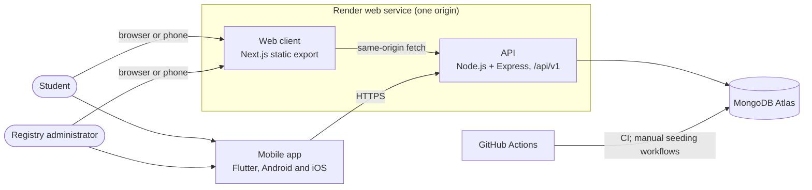
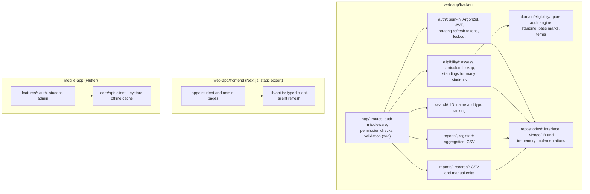
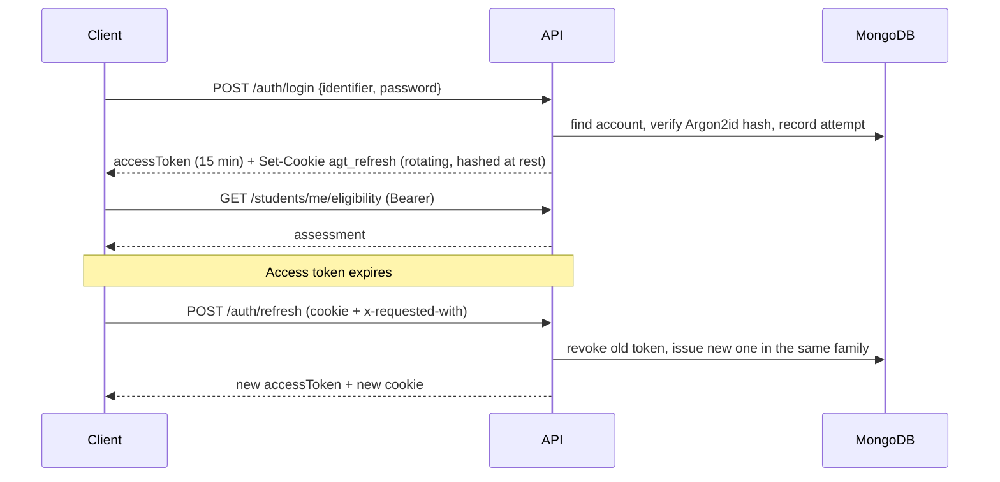

# System architecture

## Context

- **One origin.** The API serves the static web client and the legacy demo at `/demo/`, so the browser needs no CORS and cookies stay first-party ([ADR 0001](adr/0001-single-origin-render-service.md)).
- **Mobile** calls the same API over HTTPS. Native requests carry no `Origin`, so CORS does not apply. The app stores the refresh cookie in the platform keystore.

## Containers and main components

| Layer | Responsibility | Notes |
|---|---|---|
| `domain/eligibility` | Pure functions: programme audit, requirement tree, standing, pass marks, terms | No I/O; most of the backend's unit tests sit here |
| `eligibility` | Picks the curriculum for a student (Registry-reviewed for real students, illustrative synthetic rules for synthetic ones), applies the pass-mark catalogue and standing thresholds | Loads each distinct curriculum once per request when assessing many students |
| `repositories` | One interface (`types.ts`) with MongoDB (`mongo.ts`) and in-memory (`testing/memory-repositories.ts`) implementations | A shared contract test suite runs against both; MongoDB runs in CI |
| `http` | Routing, `authenticate`, `requirePermission`, input validation, audit logging | The role always comes from the stored account, never from the client |

## Key flows

**Sign-in and session**

**Assessment.** Request → student record → curriculum (reviewed or synthetic) → apply pass marks → audit engine → standing with the configured thresholds → requirement tree and next actions. The register, reports and standing-based messaging all use the same path, so every screen agrees.

## Deployment and environments

| Environment | Where | Data |
|---|---|---|
| Live | Render web service from `main`, MongoDB Atlas | Seeded synthetic records and real accounts. No real student records until the Registry approves the curriculum |
| CI | GitHub Actions: backend (Node 22), MongoDB contract tests, frontend unit and Playwright (with axe), mobile (Flutter 3.47.9, APK) | In-memory and temporary MongoDB |
| Local | `npm run dev:demo` | In-memory synthetic data |

See [`../08-deployment/render-deployment-guide.md`](../08-deployment/render-deployment-guide.md), [`../08-deployment/environment-variables.md`](../08-deployment/environment-variables.md) and [`../08-deployment/mobile-release-guide.md`](../08-deployment/mobile-release-guide.md).
